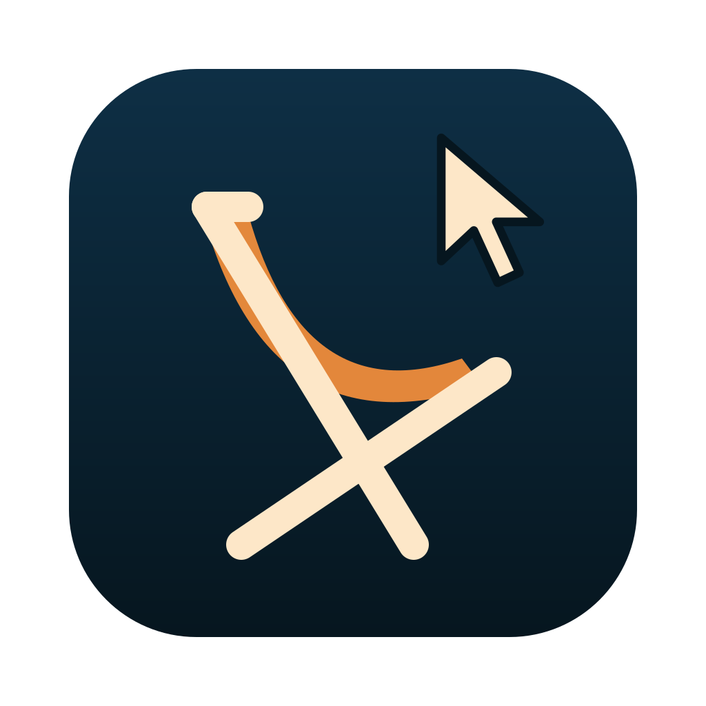

<div align="center">

#  Deckchair

**Let an AI agent drive your Mac while you lie back.**

Mouse · Keyboard · Screenshots · Screen recording · RDP

A single-file MCP server that gives Claude Code (or any MCP client) eyes and hands on the macOS desktop, including apps inside a Remote Desktop session.

[](https://www.python.org)
[](https://modelcontextprotocol.io)
[](https://docs.astral.sh/uv/)
[](#install)
[](LICENSE)

</div>

---

## Why Deckchair

- 🖥️ **The whole desktop, not just a browser.** Any app: native, Electron, or a Windows app inside Microsoft Windows App (RDP).
- 🔌 **Works on any Claude plan.** Claude Code's built-in computer use needs Pro / Max / Ultra; Deckchair is a plain MCP server.
- 👀 **Every action shows its result.** Each click, key and scroll returns a fresh screenshot.
- 🛑 **You can always stop it.** Push the mouse into any screen corner and every action aborts.
- 🔒 **One driver at a time.** A lock keeps two sessions from fighting over the mouse.
- 🔎 **Reads the screen exactly.** OCR returns the text and where it is, so numbers aren't guessed from pixels.
- 🪶 **One file, three dependencies.** `server.py` with `mcp`, `pyobjc-framework-Quartz` and `pyobjc-framework-Vision`, run by `uv`.

## Tools

| Tool | What it does |
|---|---|
| `screenshot` | Screenshot of the main display; image pixels equal click coordinates |
| `zoom` | A region at native (2×) resolution, to read small text and digits |
| `find_text` | OCR (macOS Vision): text lines with click points; find a label and click it, read exact numbers |
| `activate_app` | Bring an app to the front by name or bundle id, launching it if needed |
| `click` | Left, right or middle click; `clicks=2` for a double click |
| `move` | Move the mouse (hover) |
| `drag` | Drag with the left button |
| `scroll` | Scroll by wheel ticks |
| `type_text` | Type text into the focused field |
| `key` | A key or combo: `enter`, `cmd+tab`, `shift+home`, `ctrl+alt+delete` |
| `wait` | Wait up to 30 s without acting, then a screenshot |
| `save_screenshot` | Save a full-resolution `.png` / `.jpg` to a file |
| `start_recording` / `stop_recording` | Record the screen or a region to an `.mp4`, clicks shown; returns a contact sheet |

### Screen videos

Recordings are made to be watched, not endured:

- While recording, the mouse glides to each target and pauses 0.7 s before and after the action.
- `stop_recording` cuts duplicate still frames (`mpdecimate`): pauses play 3× faster, motion stays real-time, a short toast stays visible.
- H.264 MP4, at most 1280 px wide, `faststart`: plays inline in Jira, Slack and GitHub.
- A contact sheet (up to 8×8 tiles) lets the agent check every step is in the video.

The encoding needs [ffmpeg](https://ffmpeg.org) (`brew install ffmpeg`); without it the raw `.mov` is kept.

## Install

Deckchair runs on **macOS** and needs [uv](https://docs.astral.sh/uv/). `uv` installs the dependencies on first run.

```sh
git clone git@github.com:gandriyko/deckchair.git ~/Projects/deckchair
claude mcp add -s user deckchair -- uv run --script ~/Projects/deckchair/server.py
claude mcp get deckchair        # should say Connected
```

`-s user` makes the server available in every project. The tools appear in a **new** session (`/exit`, then `claude --continue`).

### macOS permissions

The server runs as a child of your terminal, so macOS asks about the terminal app (Terminal, iTerm, Ghostty, Herdr…):

1. **System Settings → Privacy & Security → Accessibility**: turn the terminal on (mouse and keyboard).
2. **System Settings → Privacy & Security → Screen Recording**: turn the terminal on (screenshots and video).
3. Quit and reopen the terminal.

## Safety

- **Fail-safe.** Before every action, and before every typed character, Deckchair checks the mouse. In a screen corner it refuses with `ABORTED BY USER`, and the agent stops and asks. Hold the mouse there until the agent stops.
- **One process.** The first tool call takes a lock (`$TMPDIR/deckchair.lock`, holding the PID). Another session gets an error naming that PID. The lock goes away when the session exits.
- **Action log.** Every acting call (click, type, key, scroll, drag, app switch, wait, files, recording) is appended to `~/.deckchair/actions-YYYY-MM-DD.jsonl`, one JSON line per call and one file per day: time, process, tool, arguments, front app, result or error. Appending costs ~50 µs whatever the file size. Typed text is in the log. Looking (`screenshot`, `zoom`, `find_text`) is not logged.
- **No per-app approval.** Unlike built-in computer use, Deckchair does not ask before touching an app. Approve its tools per call, not "always", until you trust the workflow.
- **Screenshots go to the model.** Close what the agent should not see.
- **Sign in yourself.** The agent never types passwords; log in to RDP and apps before handing over.

## Remote Desktop (Windows App)

Deckchair sends real key codes, left/right modifier bits and HID-state events, so RDP clients see a physical keyboard.

| Works in RDP | Limits |
|---|---|
| Clicks, menus, drop-downs, scroll | Main display only |
| OCR of English, Ukrainian, Russian and digits | OCR can't read Hebrew (Vision has no Hebrew model) |
| Text with capitals and symbols | Non-ASCII text takes ~2 s per `type_text` call |
| Cyrillic and other non-ASCII text, through the clipboard | The window flicks to Finder and back once per paste |
| `shift`, `ctrl`, `alt`, `cmd` combos | |

Non-ASCII text can't be typed into RDP: the client sends key codes only. `type_text` puts the whole text on the clipboard, switches to Finder and back (Windows App syncs the clipboard to the remote side only when it becomes active), presses `ctrl+v` and restores your clipboard. The remote clipboard keeps the pasted text.

## AI agents

[`skills/deckchair/SKILL.md`](skills/deckchair/SKILL.md) teaches an agent how to drive the desktop safely: look first, check every result, stop on abort, confirm before anything irreversible. Link the folder into the agent's skills directory, so it stays in sync with the repository:

```sh
ln -s ~/Projects/deckchair/skills/deckchair ~/.claude/skills/deckchair
```

## Development

```sh
uv run --script check.py        # key table, screenshot size and speed, fail-safe, lock, files
```

`check.py` takes the lock too: stop any session that is using Deckchair first. Project rules for agents are in [`CLAUDE.md`](CLAUDE.md).

## License

[MIT](LICENSE)
